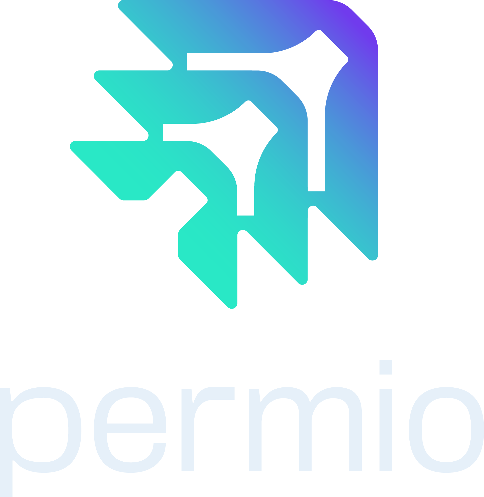

    

Permio (perms.io) is permissions as a service. It gives you **resource-level role-based access control (RBAC)**: you
define permissions and roles, grant them to your users on **resource URIs**, and ask one question from your code:

> May principal **alice** do **document.read** on **/documents/42**?

Manage everything in the dashboard at [app.perms.io](https://app.perms.io), and check permissions through the API.

---

## Key features

### Resource-level RBAC

Grant access to individual objects, such as `/projects/42` or `/documents/42/comments/7`, not just to whole types.

### Hierarchical inheritance

A grant on `/documents` applies to `/documents/42` and everything beneath it, including resources created later.
The `_` wildcard segment lets one grant cover a whole level. See [Resources and inheritance](concepts/resources.md).

### Groups

Grant to a group such as `group:editors` once, and every member holds the grant. See [Groups](concepts/groups.md).

### Bring your own authentication

perms.io only does authorisation. Principals are whatever IDs your app already uses, so it works with any login
system.

### API first

- One **REST/JSON**, **gRPC** and **gRPC-web** API. See the [API reference](api-reference/index.md).
- A **[TypeScript SDK](sdk/typescript.md)** with check helpers, typed errors, retries and iterators.
- A dashboard for managing projects, permissions, roles, grants and API keys.

---

## Get started

- **[Quickstart](quickstart.md)**: from sign-up to a passing check in five minutes.
- **[How it works](how-it-works.md)**: permissions, roles, principals and grants.
- **[API keys](concepts/api-keys.md)**: key format, access levels and invalidation.
- **[IAM fundamentals](iam-basics.md)**: background on access control in general.

---

## Support

Questions or problems? Email [hello@perms.io](mailto:hello@perms.io).
